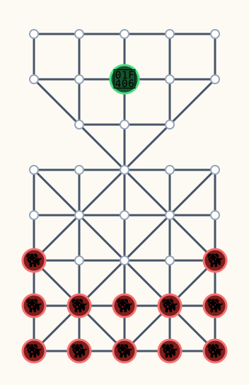

# 🐆 Komikan

**[komikan.tequionet.org](https://komikan.tequionet.org)**

**Komikan** is a traditional Mapuche board game, and this project is a web
version of it: one puma against twelve dogs, on a board shaped like a mountain
above a valley.

## The pitch

The mountain and the valley share a single pass.

One **Pangui** — the puma — waits in the high triangle. Twelve **Pu Trewa** —
the dogs — hold the wide square below. The puma moves first, sliding along the
lines of the board, and it takes a dog by leaping over it. The dogs never take
the puma; they win by surrounding it, closing every escape until nothing on
the board can move.

A whole game takes minutes. It is the oldest kind of game: two people, one
small board, and a decision that cannot be taken back.

## The game

| | |
|---|---|
| **Players** | Two, one for the Pangui, one for the Pu Trewa |
| **Board** | An expanded Alquerque board: a 5×5 Alquerque square with a triangular section above it, sharing the square's top row. **38 points, 79 connections.** |
| **Pieces** | 1 Pangui (puma), 12 Pu Trewa (dogs) |
| **Turns** | The Pangui moves first, then the players alternate |
| **Movement** | One segment along the lines of the board, in any direction, to an empty point |
| **Capture** | Only the Pangui captures, by jumping over a Trewa. Consecutive captures are allowed and count as one turn. |
| **Victory** | The Pangui wins by capturing six Trewa. The Trewa win by leaving the Pangui with no legal move. |

The game exists in several regional and historical variants — the shape of the
triangle, the capture threshold and the movement restrictions all differ
between sources. This project plays one specific, fully documented variant,
and keeps the board and the rules as separate data so that other variants can
be added later.

## The board



```
    o --- o --- o --- o --- o
    |     |     |     |     |
    o --- o --- x --- o --- o
       \  |     |     |  /
          o --- o --- o
             \  |  /
    o --- o --- o --- o --- o
    |  \  |  /  |  \  |  /  |
    o --- o --- o --- o --- o
    |  /  |  \  |  /  |  \  |
    x --- o --- o --- o --- x
    |  \  |  /  |  \  |  /  |
    x --- x --- x --- x --- x
    |  /  |  \  |  /  |  \  |
    x --- x --- x --- x --- x
```

`x` is a Trewa, `o` is an empty point. The Pangui starts in the middle of the
second row, up in the triangle.

The authoritative node and edge list lives in
[`features/komikan-board-layout.md`](features/komikan-board-layout.md).

## Status

Under construction. What exists today:

- the board as data in Go (`internal/board`), with a validator and tests that
  re-prove the topology from scratch;
- an ASCII and an SVG renderer, used both by the home page and by the
  board dump command;
- the home page, served by a single static Go binary: a button that starts a
  game, a link to the rooms, and a short description of the game;
- rooms and player identities: a browser gets an identity on its first
  visit, creates a room, shares the link, and the second player joins it.
  The roles are dealt at random when the second player arrives. The rooms
  live at `/rooms/`, and the home page stays at `/`;
- the rules of the game (`internal/rules`): legal moves, captures, turns,
  and victory, all driven by a configurable ruleset;
- moves over HTTP, decided by the server, and a board in the browser drawn
  from the same graph the rules engine plays on;
- a test suite that plays whole games through the API, restarts the service
  against the same database file, and proves that two moves submitted at the
  same moment leave exactly one of them standing;
- a test of the room page, which proves that the dog the player picked is the
  dog that moves;
- the service on the VPS, with a runbook for backups, restarts and health.

Next: the remaining interface work, and the answer to the open rule questions.

Some rules are still open questions and are tracked in `issues/`.

## Development

Requires Go 1.27 or newer.

```sh
go test ./...                     # run the tests
node --test "web/**/*.test.js"        # run the test of the room page
go run ./cmd/server               # serve the site on 127.0.0.1:18082
go run ./cmd/boarddump            # print the board as ASCII
go run ./cmd/boarddump -svg docs/board.svg   # regenerate the board image
```

Deploying to production cross-builds the server for linux/amd64, copies it to
the VPS, restarts the service and health-checks the public URL:

```sh
sh deploy.sh
```

## Repository layout

| Path | What lives there |
|---|---|
| `cmd/server` | The web server entry point |
| `cmd/boarddump` | Prints or writes the board rendering |
| `internal/board` | Board topology, positions, validation, rendering |
| `internal/httpapi` | Routing, identities, rooms, JSON shapes |
| `internal/store` | Persistence: players, rooms, seats, games, moves |
| `web/` | The static pages, embedded in the binary, and the test of the room page |
| `docs/` | Design documents: rules, application spec, original board sketch |
| `features/` | Durable knowledge about the system as built |
| `issues/`, `tasks/` | Open questions and planned work |
| `workflow/` | How work is planned and recorded here |

## Further reading

- [`docs/overview.md`](docs/overview.md) — rules and implementation spec
- [`docs/spec.md`](docs/spec.md) — application and HTTP spec
- [`features/komikan-board-layout.md`](features/komikan-board-layout.md) — the board, in full
- [`features/komikan-web-api.md`](features/komikan-web-api.md) — identities, rooms, endpoints
- [`features/komikan-rules.md`](features/komikan-rules.md) — the rules as they are implemented
- [`features/komikan-deployment-runbook.md`](features/komikan-deployment-runbook.md) — the service on the VPS
- [`features/tao-vps-go-service-deployment.md`](features/tao-vps-go-service-deployment.md) — how it is deployed
